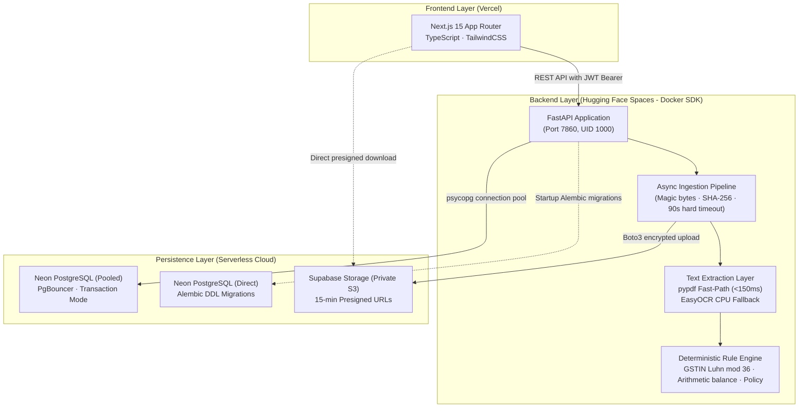

# Finance Flow AI

> **Deterministic Invoice Processing, Regulatory Verification & Automated ERP Reconciliation**

Finance Flow AI is a production-hardened platform for corporate invoice verification, automated accounts payable auditing, and human-in-the-loop exception handling.

Unlike probabilistic GenAI wrappers, **Finance Flow AI excludes LLMs from the financial approval path**. Decisions are 100% deterministic, audit-logged, and verified against mathematical constraints and regulatory checksum standards.

---

## 1. System Architecture



---

## 2. Key Capabilities

- **Zero LLM in Approval Path**: Approvals and rejections are dictated strictly by deterministic policy rules, GSTIN checksums, and arithmetic line-item balancing.
- **Hybrid Extraction Pipeline**:
  - **Fast-path (`pypdf`)**: High-speed digital PDF parser extracting embedded text in $< 150\text{ ms}$ with negligible RAM overhead.
  - **CPU-Optimized Fallback (`EasyOCR`)**: Deep-learning optical character recognition for scanned receipts and images running on CPU-only PyTorch with pre-downscaled images ($\le 1600\text{ px}$) and `torch.no_grad()`.
  - **Pre-baked Models**: Model weights are downloaded at Docker build time into `/app/models/easyocr`, avoiding runtime download latency or Hugging Face Space startup failures.
- **Asynchronous Ingestion**: `POST /api/invoices` validates magic bytes, computes SHA-256 hashes, detects duplicates, stores documents, and responds with `202 Accepted` in milliseconds. Workers execute processing under a hard 90-second timeout.
- **Enterprise Multi-Tenancy**: Every database query is scoped by `organization_id`. Cross-tenant queries return `404 Not Found`.
- **Private S3 Storage & Presigned URLs**: Invoices reside in private buckets. Access is granted exclusively through short-lived presigned URLs.
- **Immutable Audit Trail**: Every automated check, status change, and human review is permanently logged in `audit_logs`.

---

## 3. Local Development with Docker Compose

Run the complete stack (backend + PostgreSQL database) locally:

```bash
# 1. Clone repository
git clone https://github.com/your-username/FinanceFlowAI.git
cd FinanceFlowAI

# 2. Launch backend and PostgreSQL
docker-compose up --build
```

The backend starts at `http://localhost:7860`. You can inspect the interactive OpenAPI documentation at `http://localhost:7860/docs`.

To run the Next.js frontend locally:

```bash
cd frontend
npm install
npm run dev
```

Visit `http://localhost:3000` to access the dashboard.

---

## 4. Environment Variables Reference

Copy `.env.example` to `.env` to configure the application.

| Variable | Required | Default | Description |
|---|---|---|---|
| `ENVIRONMENT` | Yes | `development` | Runtime environment (`development`, `staging`, `production`). In `production`, local storage is blocked. |
| `SECRET_KEY` | Yes | — | Cryptographic secret for signing JWT tokens. Must be $\ge 32$ characters. |
| `DATABASE_URL` | Yes | — | PostgreSQL connection string. In production, points to Neon pooled endpoint (`-pooler...sslmode=require`). |
| `DATABASE_URL_DIRECT` | Optional | — | Non-pooled connection string used exclusively by Alembic migrations. |
| `STORAGE_BACKEND` | Yes | `local` | Storage provider: `s3` for production, `local` for offline development. |
| `S3_ENDPOINT_URL` | If S3 | — | Endpoint URL for S3-compatible service (e.g. `https://<ref>.supabase.co/storage/v1/s3`). |
| `S3_REGION` | If S3 | `us-east-1` | S3 bucket region. |
| `S3_ACCESS_KEY_ID` | If S3 | — | S3 Access Key ID. |
| `S3_SECRET_ACCESS_KEY`| If S3 | — | S3 Secret Access Key. |
| `S3_BUCKET` | If S3 | `invoices` | Target private S3 bucket. |
| `FRONTEND_ORIGINS` | Yes | `["http://localhost:3000"]` | JSON array of permitted CORS origins. |
| `FRONTEND_PREVIEW_REGEX`| Optional | — | Regex for permitted Vercel preview deployment URLs. |
| `OCR_CONCURRENCY` | No | `1` | Maximum concurrent OCR tasks permitted on CPU. |
| `MAX_UPLOAD_BYTES` | No | `10485760` | Maximum file upload size in bytes (10 MB). |

---

## 5. Production Deployment Order

Deploy the target architecture components in this exact order:

1. **Neon PostgreSQL Database**:
   - Create a project at [Neon Console](https://console.neon.tech).
   - Collect the **Pooled URL** (`DATABASE_URL`, contains `-pooler`) and **Direct URL** (`DATABASE_URL_DIRECT`).
2. **Supabase Storage Bucket**:
   - Create a private bucket named `invoices` in [Supabase](https://supabase.com).
   - Generate S3 Access Keys from Project Settings.
3. **Hugging Face Space Backend**:
   - Create a new Space with the **Docker** SDK (CPU Basic hardware).
   - Set app port to `7860`.
   - Add backend secrets (`DATABASE_URL`, `DATABASE_URL_DIRECT`, `SECRET_KEY`, `S3_*`, `FRONTEND_ORIGINS`).
   - Push `/backend` directory to the Space.
4. **Vercel Frontend**:
   - Import the repository in [Vercel](https://vercel.com) with root directory set to `frontend`.
   - Set `NEXT_PUBLIC_API_URL` to `https://<your-space-name>.hf.space`.
   - Update backend `FRONTEND_ORIGINS` with your assigned Vercel URL.

*For complete step-by-step instructions, see [docs/DEPLOYMENT.md](docs/DEPLOYMENT.md).*

---

## 6. Free-Tier Characteristics & Cold-Start UX

- **Hugging Face Space Sleep**: Free CPU Basic Spaces pause after 48 hours of inactivity. The Next.js frontend pings `/health` on mount, displaying an alert banner (*"Server is waking up (up to ~60 s)"*) while retrying with exponential backoff until the Space initializes.
- **Neon Scale-to-Zero**: Neon compute terminates after 5 minutes of inactivity. The backend SQLAlchemy connection listener automatically retries dropped connections upon first query wake-up.
- **CPU OCR Concurrency**: Optical character recognition is throttled to 1 worker per container to stay well within CPU Basic performance limits.

---

## 7. Troubleshooting

| Issue | Root Cause | Solution |
|---|---|---|
| Startup fails: `SECRET_KEY must be at least 32 characters` | Weak or missing secret key | Generate a secure key using `openssl rand -hex 32` and set `SECRET_KEY`. |
| Startup fails: `STORAGE_BACKEND='local' is forbidden in production` | Storage misconfiguration | Set `STORAGE_BACKEND=s3` and configure `S3_*` credentials. |
| Database error: `prepared statement already exists` | PgBouncer collision | Verify `prepare_threshold=None` in connection arguments (already configured in `backend/app/database.py`). |
| Ingestion returns `415 Unsupported Media Type` | Magic bytes mismatch | Verify the uploaded file is a valid PDF or supported image format (not an executable renamed to `.pdf`). |
| Ingestion returns `413 Request Entity Too Large` | Exceeded 10 MB limit | Ensure file size is under 10 MB. |
| CORS failure in browser console | Origin not whitelisted | Update `FRONTEND_ORIGINS` in backend environment variables to include your frontend domain. |

---

## 8. Documentation

- [System Architecture](docs/ARCHITECTURE.md)
- [REST API Reference](docs/API.md)
- [Production Deployment Guide](docs/DEPLOYMENT.md)
