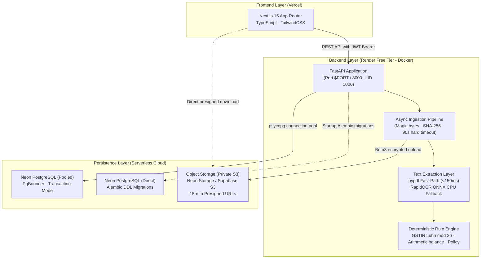

# Finance Flow AI

> **Deterministic Invoice Processing, Regulatory Verification & Automated AP Reconciliation**

Finance Flow AI is a production-hardened platform for corporate invoice verification, automated accounts payable auditing, and human-in-the-loop exception handling.

Unlike probabilistic GenAI wrappers, **Finance Flow AI excludes LLMs from the financial approval path**. Decisions are 100% deterministic, audit-logged, and verified against mathematical constraints and regulatory checksum standards.

---

## 1. System Architecture



---

## 2. Key Capabilities & Engineering Highlights

- **Zero LLM in Approval Path**: Approvals and rejections are dictated strictly by deterministic policy rules, GSTIN checksums, and arithmetic line-item balancing.
- **Dual-Engine Extraction Architecture**:
  - **Fast-path (`pypdf`)**: High-speed digital PDF parser extracting embedded text in $< 150\text{ ms}$ with negligible RAM overhead.
  - **Lightweight Fallback (`RapidOCR`)**: ONNX Runtime CPU inference for scanned receipts and images. Uses quantized models (~14 MB), with zero PyTorch/Tesseract dependencies.
  - **Engineered for Render 512 MB Free Tier**: Measured peak working set is **280.38 MB**, leaving **231.62 MB (45.2% headroom)** under Render's 512 MB cgroup memory limit.
  - **Pre-baked Models**: Model weights are packaged directly into the container during Docker build, guaranteeing instant startup.
- **Asynchronous Ingestion**: `POST /api/invoices` validates magic bytes, computes SHA-256 hashes, detects duplicates, stores documents, and responds with `202 Accepted` immediately. Background workers execute processing under a hard 90-second timeout.
- **Enterprise Multi-Tenancy**: Every database query is scoped by `organization_id`. Cross-tenant queries return `404 Not Found`.
- **Private S3 Storage & Presigned URLs**: Invoices reside in private buckets. Access is granted exclusively through short-lived presigned URLs.
- **Immutable Audit Trail**: Every automated check, status change, and human review is permanently logged in `audit_logs`.
- **Offline Laptop Backup Mode**: Complete app runs locally on Windows without Docker or internet connection for live demo safety.

---

## 3. Quick Start: Local Development

### Option A: Local Python & Node.js (No Docker, Offline Ready)

#### 1. Backend (Terminal 1)
```powershell
cd backend
python -m venv .venv
.\.venv\Scripts\activate
pip install -r requirements.txt
alembic upgrade head
uvicorn app.main:app --host 127.0.0.1 --port 8000 --reload
```
API docs available at `http://127.0.0.1:8000/docs`.

#### 2. Frontend (Terminal 2)
```powershell
cd frontend
npm install
npm run dev
```
Visit `http://localhost:3000` to access the dashboard. Default credentials:
- **Email**: `admin@financeflow.ai`
- **Password**: `admin123`

### Option B: Docker Compose (Backend + PostgreSQL)

```bash
docker compose up --build
```

---

## 4. Environment Variables Reference

Copy `backend/.env.example` to `backend/.env` and `frontend/.env.example` to `frontend/.env.local`.

### Backend Variables

| Variable | Required | Default | Description |
|---|---|---|---|
| `ENVIRONMENT` | Yes | `development` | Runtime environment (`development`, `test`, `production`). In `production`, local storage is blocked. |
| `SECRET_KEY` | Yes | — | Cryptographic secret for signing JWT tokens. Must be $\ge 32$ characters. |
| `DATABASE_URL` | Yes | — | PostgreSQL connection string. In production, points to Neon pooled endpoint (`-pooler...sslmode=require`). |
| `DATABASE_URL_DIRECT` | Optional | — | Non-pooled connection string used exclusively by Alembic migrations. |
| `STORAGE_BACKEND` | Yes | `local` | Storage provider: `s3` for production, `local` for offline development. |
| `S3_ENDPOINT_URL` | If S3 | — | Endpoint URL for S3-compatible service (e.g. Neon Object Storage or Supabase Storage). |
| `S3_REGION` | If S3 | `us-east-2` | S3 bucket region. |
| `S3_ACCESS_KEY_ID` | If S3 | — | S3 Access Key ID. |
| `S3_SECRET_ACCESS_KEY`| If S3 | — | S3 Secret Access Key. |
| `S3_BUCKET` | If S3 | `uploads` | Target private S3 bucket. |
| `FRONTEND_ORIGINS` | Yes | `["http://localhost:3000"]` | Permitted CORS origins (comma-separated or JSON array). |
| `FRONTEND_PREVIEW_REGEX`| Optional | — | Regex for permitted Vercel preview deployment URLs. |
| `OCR_CONCURRENCY` | No | `1` | Maximum concurrent OCR tasks permitted on CPU (prevents RAM spikes). |
| `MAX_UPLOAD_BYTES` | No | `10485760` | Maximum file upload size in bytes (10 MB). |

### Frontend Variables

| Variable | Required | Default | Description |
|---|---|---|---|
| `NEXT_PUBLIC_API_URL` | Yes (in prod) | `http://localhost:8000` | Backend API base URL without trailing slash. Fails build if missing in production. |

---

## 5. Deployment Overview

Deploy in this order:
1. **Neon Database**: PostgreSQL with connection pooling and scale-to-zero compute.
2. **S3 Object Storage**: Neon Object Storage or Supabase private bucket.
3. **Render Backend**: Docker Web Service running on Render 512 MB free tier.
4. **Vercel Frontend**: Next.js 15 deployment with `NEXT_PUBLIC_API_URL` set.

*Detailed deployment walkthrough: [docs/DEPLOYMENT.md](docs/DEPLOYMENT.md)*  
*College demo script & offline backup guide: [docs/DEMO_GUIDE.md](docs/DEMO_GUIDE.md)*  
*System Architecture: [docs/ARCHITECTURE.md](docs/ARCHITECTURE.md)*  
*REST API Reference: [docs/API.md](docs/API.md)*
