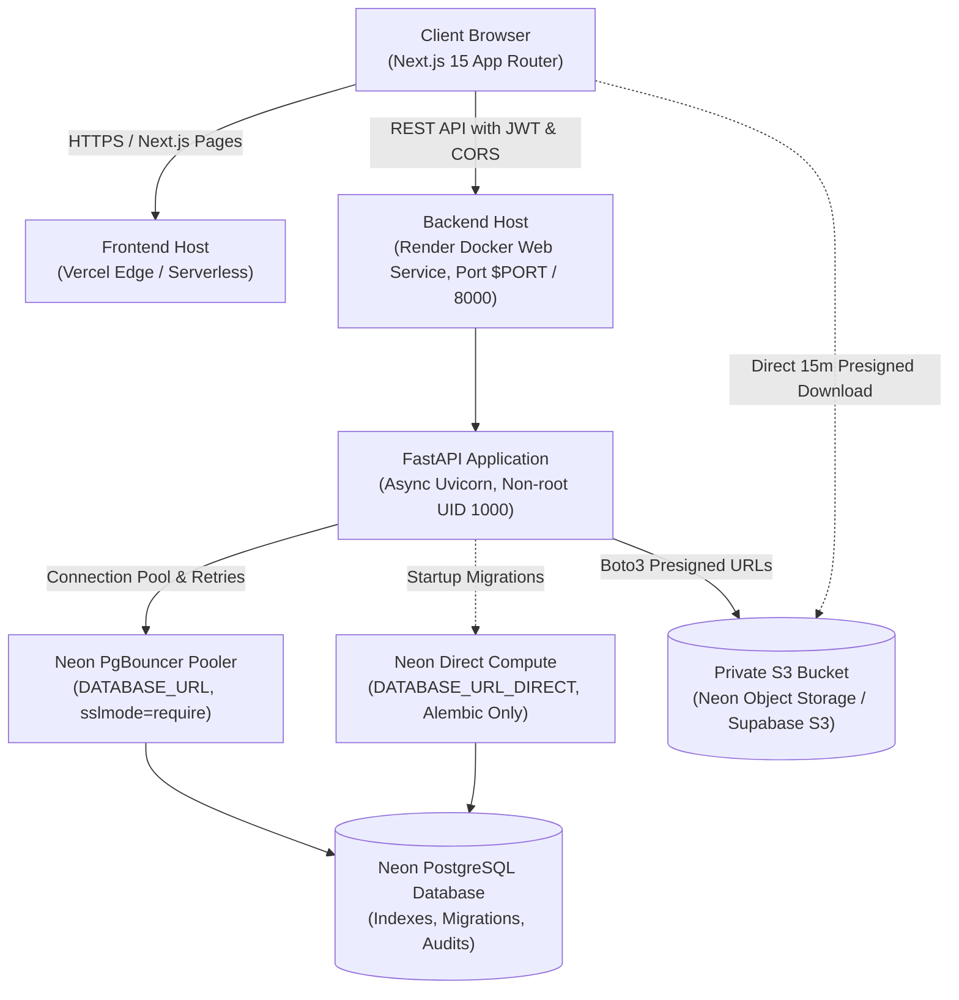
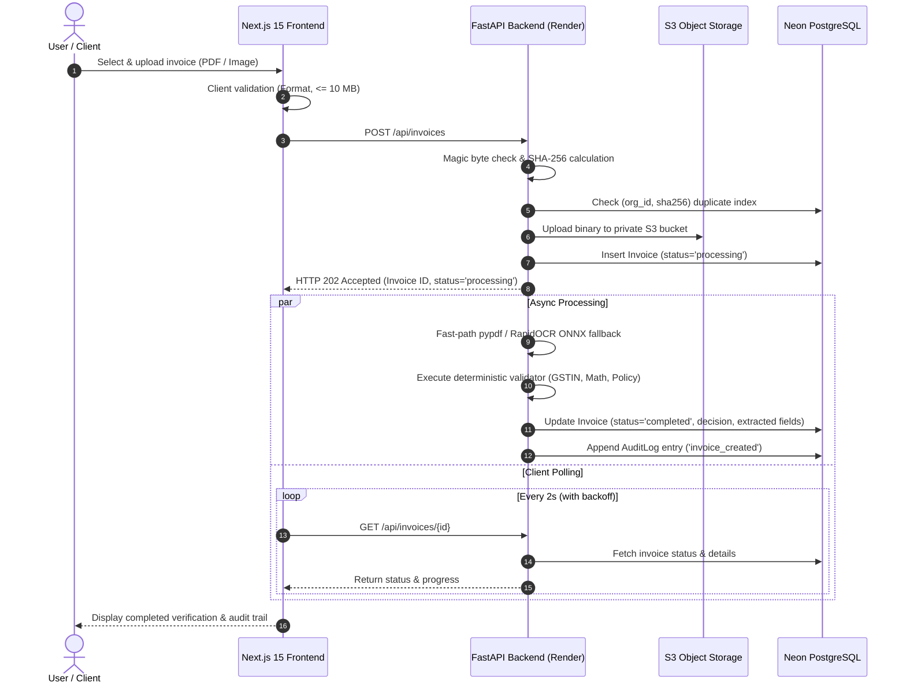

# Finance Flow AI — System Architecture

Finance Flow AI is an enterprise-grade automated invoice processing, deterministic validation, and human-in-the-loop reconciliation platform.

---

## 1. High-Level Target Architecture

---

## 2. Core Architectural Pillars

### A. Deterministic Rule Engine (Zero LLM in Approval Path)
Financial reconciliation requires 100% auditable, repeatable outcomes. To eliminate hallucination risks, latency spikes, and regulatory non-compliance:
- **Zero LLM dependency**: LLMs are completely excluded from validation calculations, checksums, and financial approvals.
- **Indian GSTIN Verification**: Validates 15-character alphanumeric format, state code boundaries (01–38, 97, 99), and executes the ISO/IEC 7064 (Luhn mod 36) checksum algorithm.
- **Arithmetic Consistency**: Verifies that `Subtotal + Taxes == Total` within a tight tolerance boundary of $\le \text{INR } 1.00$ to accommodate rounding.
- **Deterministic Decision Thresholds**:
  - `Confidence < 0.40` $\rightarrow$ `REJECT`
  - `0.40 <= Confidence < 0.85` $\rightarrow$ `PENDING REVIEW`
  - `Confidence >= 0.85` AND `Total < INR 200,000` $\rightarrow$ `APPROVE`
  - `Total >= INR 200,000` $\rightarrow$ `PENDING REVIEW` (Strict enterprise segregation of duties).

### B. High-Performance Text Extraction & Render 512 MB Optimization
- **Digital PDF Fast-Path (`pypdf`)**: Native digital invoices containing embedded text layers bypass optical recognition, finishing extraction in under 150 ms with negligible RAM overhead.
- **Lightweight Fallback (`RapidOCR`)**: Scanned PDFs and image uploads (PNG, JPEG, TIFF, WEBP, BMP) are processed using RapidOCR powered by ONNX Runtime CPU.
- **Elimination of Heavy Frameworks**: Tesseract, PyTorch, and EasyOCR were completely removed, replacing 700+ MB dependencies with ~14 MB quantized ONNX models.
- **Measured RAM Footprint**:
  | Execution Stage | Working Set (Current) | Peak Working Set (RSS) | Headroom under 512 MB |
  |---|---|---|---|
  | Baseline Python process | 16.44 MB | 16.44 MB | 495.56 MB (96.8%) |
  | FastAPI + DB Models loaded | 86.81 MB | 86.81 MB | 425.19 MB (83.0%) |
  | RapidOCR init & warmup | 153.76 MB | 229.91 MB | 282.09 MB (55.1%) |
  | Digital PDF extraction (`pypdf`) | 161.49 MB | 229.91 MB | 282.09 MB (55.1%) |
  | Scanned receipt extraction (`RapidOCR`) | 165.34 MB | **280.38 MB** | **231.62 MB (45.2% free)** |
- **Pre-baked Models**: Model weights are packaged directly into the container image during Docker build to avoid runtime network downloads or startup delays.
- **Configurable Concurrency**: Regulated via an asynchronous semaphore controlled by `OCR_CONCURRENCY` (default: 1) to prevent CPU or memory starvation.

### C. Asynchronous Ingestion & Task Orchestration
To avoid long-lived HTTP socket timeouts and client disconnects:
1. `POST /api/invoices`:
   - Validates magic bytes (detects spoofed extensions such as `.exe` renamed to `.pdf`).
   - Rejects payloads exceeding 10 MB.
   - Computes SHA-256 digest of binary content.
   - Checks `(organization_id, sha256)` index for instant duplicate detection.
   - Saves file to S3 private storage.
   - Creates `invoices` row with `status='processing'`.
   - Returns HTTP 202 Accepted immediately.
2. Background Worker Execution:
   - Dispatches extraction and deterministic validation under a hard 90-second timeout.
   - Updates record to `completed` or `failed` (persisting `error_reason`).
3. Container Crash Recovery:
   - On container startup, any invoices stuck in `processing` older than 10 minutes are marked as `failed` with reasons indicating container restart interruption.

---

## 3. Security & Multi-Tenancy Architecture

1. **Strict Organization Scoping**: Every database query is scoped by `organization_id`. Attempting to access another organization's invoice returns `404 Not Found`.
2. **Short-Lived Presigned URLs**: Invoice documents are stored in private S3 buckets. Direct access URLs expire after 15 minutes.
3. **Data Protection**: GSTIN numbers and raw invoice contents are never logged at INFO level.
4. **Resilient Connection Handling**: Connection recycling (`pool_recycle=300`), health pre-pings (`pool_pre_ping=True`), and automatic retry listeners recover seamlessly from Neon database scale-to-zero wake-ups.
