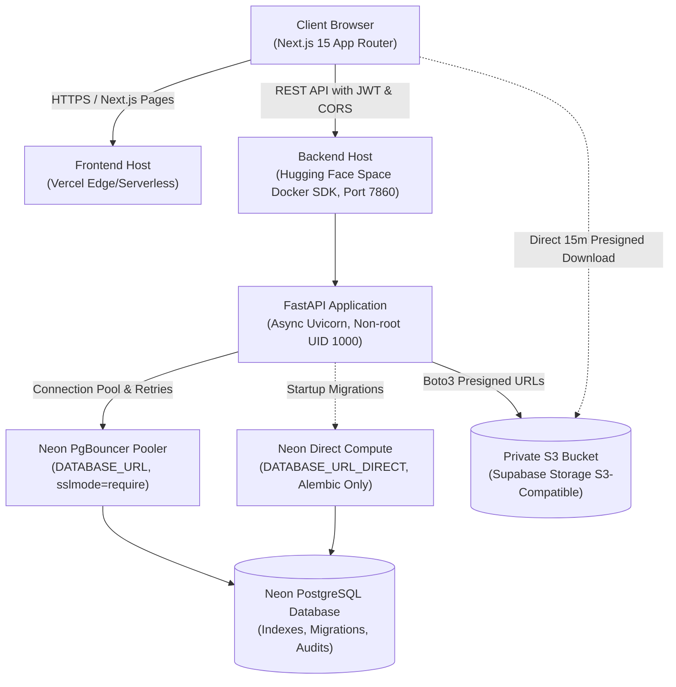
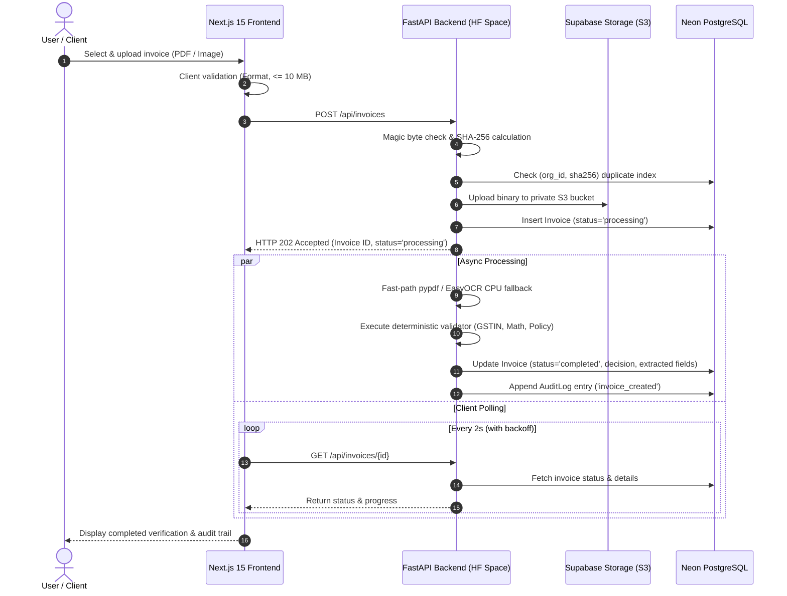

# Finance Flow AI — System Architecture

Finance Flow AI is an enterprise-grade automated invoice processing, deterministic validation, and human-in-the-loop reconciliation platform.

---

## 1. High-Level Target Architecture

---

## 2. Core Architectural Pillars

### A. Deterministic Rule Engine (Zero LLM in Approval Path)
Financial reconciliation requires 100% auditable, repeatable outcomes. To eliminate hallucination risks, latency spikes, and regulatory non-compliance:
- **Zero LLM dependency**: LLMs are completely excluded from validation calculations, checksums, and financial approvals.
- **Indian GSTIN Verification**: Validates 15-character alphanumeric format, state code boundaries (01–38, 97, 99), and executes the ISO/IEC 7064 (Luhn mod 36) checksum algorithm.
- **Arithmetic Consistency**: Verifies that `Subtotal + Taxes == Total` within a tight tolerance boundary of $\le \text{INR } 1.00$ to accommodate rounding.
- **Deterministic Decision Thresholds**:
  - `Confidence < 0.40` $\rightarrow$ `REJECT`
  - `0.40 <= Confidence < 0.85` $\rightarrow$ `PENDING REVIEW`
  - `Confidence >= 0.85` AND `Total < INR 200,000` $\rightarrow$ `APPROVE`
  - `Total >= INR 200,000` $\rightarrow$ `PENDING REVIEW` (Strict enterprise segregation of duties).

### B. High-Performance Text Extraction Architecture
- **Digital PDF Fast-Path (`pypdf`)**: Native digital invoices containing embedded text layers bypass optical recognition, finishing extraction in under 150 ms with zero GPU/RAM overhead.
- **CPU-Optimized Fallback (`EasyOCR`)**: Scanned PDFs and image uploads (PNG, JPEG, TIFF, WEBP, BMP) are processed using EasyOCR running on CPU PyTorch with pre-downscaled images (max dimension 1600 px) and `torch.no_grad()`.
- **Pre-downloaded Weights**: Model weights are packaged directly into `/app/models/easyocr` during container image build to avoid runtime network downloads or Hugging Face Space timeout errors.
- **Configurable Concurrency**: Regulated via an asynchronous semaphore controlled by `OCR_CONCURRENCY` (default: 1) to prevent CPU or memory starvation.

### C. Asynchronous Ingestion & Task Orchestration
To avoid long-lived HTTP socket timeouts and client disconnects:
1. `POST /api/invoices`:
   - Validates magic bytes (detects spoofed extensions such as `.exe` renamed to `.pdf`).
   - Rejects payloads exceeding 10 MB.
   - Computes SHA-256 digest of binary content.
   - Checks `(organization_id, sha256)` index for instant duplicate detection.
   - Saves file to S3 private storage.
   - Creates `invoices` row with `status='processing'`.
   - Returns HTTP 202 Accepted immediately.
2. Background Worker Execution:
   - Dispatches extraction and deterministic validation under a hard 90-second timeout.
   - Updates record to `completed` or `failed` (persisting `error_reason`).
3. Container Crash Recovery:
   - On container startup, any invoices stuck in `processing` older than 10 minutes are marked as `failed` with reasons indicating container restart interruption.

---

## 3. Database & Persistence Architecture

### Neon PostgreSQL Split-Connection Strategy
Neon Serverless PostgreSQL utilizes serverless scale-to-zero and PgBouncer connection pooling:
- **Runtime Pooler (`DATABASE_URL`)**:
  - Points to Neon pooled endpoint (`-pooler.region.neon.tech`).
  - Utilizes SQLAlchemy `QueuePool` with `pool_size=3`, `max_overflow=2`, `pool_pre_ping=True`, and `pool_recycle=300`.
  - Configures Psycopg 3 with `prepare_threshold=None` to ensure compatibility with PgBouncer transaction mode.
  - Implements transparent `do_connect` listener retry to seamlessly absorb cold-start connection drops during compute spin-up.
- **Migration Direct Endpoint (`DATABASE_URL_DIRECT`)**:
  - Points directly to Neon compute instance (non-pooler).
  - Used exclusively by Alembic migrations (`alembic upgrade head`) to support DDL locking and transactional migrations.

### Data Model & Compound Indexes
- Multi-tenancy is enforced at the schema level via foreign key `organization_id` on all operational entities (`invoices`, `users`, `audit_logs`).
- High-performance indexes:
  - `uq_invoices_org_sha256`: Unique compound index `(organization_id, sha256)` preventing duplicate file processing per tenant.
  - `ix_invoices_org_created_at`: Compound index `(organization_id, created_at DESC)` for efficient paginated dashboard queries.
  - `ix_invoices_org_status`: Compound index `(organization_id, status)` for polling and stuck-job recovery queries.

---

## 4. Storage Architecture

- **Private S3-Compatible Bucket**: Integrated with Supabase Storage (or standard AWS S3).
- **Zero Ephemeral Production Storage**: In `ENVIRONMENT=production`, local disk storage is blocked at startup.
- **Presigned URLs**: Invoice documents are stored privately. Client access is provided strictly through short-lived presigned URLs (15-minute expiration) generated on-demand via `boto3`.

---

## 5. Security Architecture

1. **Authentication**:
   - Modern password hashing using **Argon2id** (with legacy PBKDF2 verification fallback).
   - Cryptographically signed JWT tokens with expiration (`ACCESS_TOKEN_EXPIRE_MINUTES`).
   - Mandatory key entropy: application startup fails if `SECRET_KEY` is missing, default, or shorter than 32 characters.
2. **Strict Multi-Tenant Scoping**:
   - Every read and write query is filtered by the user's `organization_id`.
   - Access attempts to cross-tenant invoice IDs return a strict `404 Not Found` to prevent metadata leakage.
3. **CORS Governance**:
   - Whitelist configured through `FRONTEND_ORIGINS`.
   - Wildcard `.vercel.app` patterns replaced with scoped regex patterns (`FRONTEND_PREVIEW_REGEX`).
4. **Rate Limiting**:
   - Implemented via `slowapi`:
     - `/auth/login`: 10 requests / minute.
     - `/api/invoices`: 20 requests / minute.
5. **Information Protection & Error Shielding**:
   - Global exception handlers catch unhandled runtime errors, returning standard sanitized error schemas with no internal stack traces exposed to clients.
   - PII, invoice contents, and GSTINs are suppressed from `INFO`-level production logs.
